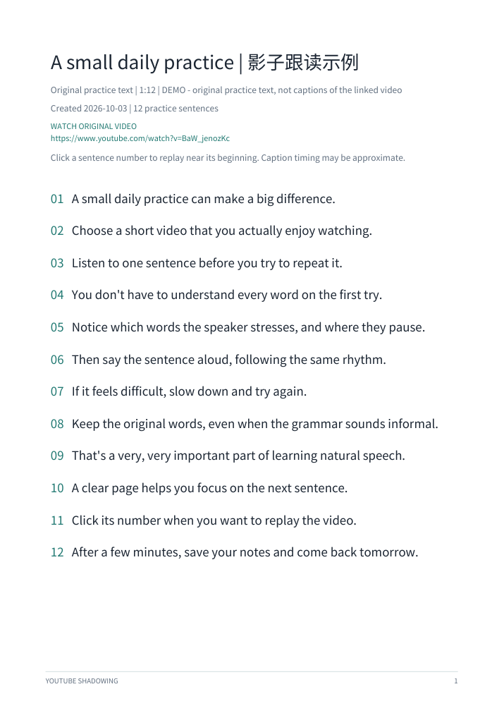

# YouTube Shadowing

**Paste a YouTube link. Get a faithful, sentence-by-sentence practice PDF in your learning folder.**

在你熟悉的 AI 助手里，把 YouTube 视频变成逐句跟读讲义。



[View the sample PDF](examples/sample-handout.pdf) · [中文说明](docs/README.zh-CN.md)

The sample uses original practice text. Its reference-video links demonstrate PDF
annotations; the sentences are not a transcript of the linked video.

## What you get

- A searchable A4 PDF with one numbered practice sentence per paragraph.
- Sentence numbers that replay near their original caption time, with timestamps
  kept out of the visible body.
- The video title, channel, caption provenance and full YouTube source link.
- Automatic filing under `Documents/YouTube Shadowing/channel/title [videoID].pdf`,
  or a folder you choose.
- A faithful transcript: punctuation improves, spoken words and repetitions stay.

The skill uses **yt-dlp for captions and your existing assistant for editing**.
There is no separate agent service or extra LLM API key. Editing uses your host's
normal model allowance. Version 0.1 handles a single video with existing English
captions; it does not silently translate or transcribe audio.

## Install

Requirements: a host that can read/write local files and run commands, plus
[uv](https://docs.astral.sh/uv/getting-started/installation/) or Python 3.11+ in a
dedicated virtual environment. With uv, dependencies install in the skill's own
environment. A first run may need internet access to resolve/install Python.

Clone the repository, then install a complete personal copy:

```text
git clone https://github.com/Babe153/youtube-shadowing.git
cd youtube-shadowing
python tools/install_skill.py --target codex
```

For Claude Code:

```text
python tools/install_skill.py --target claude-code
```

The installer refuses to overwrite an existing installation. Codex uses
`~/.agents/skills/youtube-shadowing`; Claude Code uses
`~/.claude/skills/youtube-shadowing`. `--destination PATH` overrides the parent
skills directory if your host uses a different discovery location. Reload the
host if it does not discover the new skill automatically.

For WorkBuddy, build the archives and import the WorkBuddy ZIP using its skill
import interface:

```text
python tools/build_packages.py
```

This produces self-contained Codex skill, Claude Code plugin and WorkBuddy skill
ZIPs in `dist/`. The WorkBuddy package adds its required marketplace metadata to
the same core instructions. The repository also has a Claude Code plugin manifest
and can be loaded with `claude --plugin-dir /absolute/path/to/youtube-shadowing`.

## Use

In your assistant:

> Make a shadowing PDF from this video: https://www.youtube.com/watch?v=...

或者：

> 把这个视频做成逐句影子跟读讲义：https://www.youtube.com/watch?v=...

Select the skill explicitly if a bare URL is ambiguous. Ask the assistant to
remember a folder when you want a persistent preference. An interrupted long
video can resume from its cached run directory.

The assistant follows [SKILL.md](skills/youtube-shadowing/SKILL.md). You do not need
to run the internal commands yourself. If inspecting the engine directly:

```text
uv run --project skills/youtube-shadowing --locked python skills/youtube-shadowing/scripts/shadowing.py doctor
uv run --project skills/youtube-shadowing --locked python skills/youtube-shadowing/scripts/shadowing.py extract --url "VIDEO_URL"
```

`extract` returns a run directory. `prepare` creates model input chunks; the host
writes result JSON. `next` finds unfinished work, `validate` verifies it, and
`render` checks again before publishing a PDF. This CLI deliberately does not
pretend to provide LLM editing on its own.

## Fidelity and limitations

- Display overlap is removed conservatively using caption timing/window evidence.
  Ambiguous repeats remain. No algorithm can guarantee the distinction from text
  alone, so raw captions and mappings are retained in the cache.
- Editing checks reject missing, added or changed words, quantities and
  contractions. Blocks must cover the entire cleaned source before rendering.
- Checks do not prove audio accuracy or correct punctuation. Caption mistakes
  remain unless a separate audio-verification workflow is added.
- Replay precision is word-level when supplied by JSON3, otherwise cue-level.
- Automatic captions, restricted videos and YouTube rate limits can affect access.
  Login failures are reported; browser cookies are not read automatically.
- Latin and CJK text use a bundled OFL font. Unsupported title symbols are shown
  as Unicode code points; unsupported body glyphs produce a clear error.
- Generated/user-modified PDFs are distinguished by a cache receipt and byte hash.
  Unknown files are preserved under versioned output names.

## Verification status

On Windows, the engine's automated tests, isolated installation, package builds,
real YouTube caption extraction, host-assisted editing, and PDF text/link/layout
checks have been exercised during development. The PDF fixture includes CJK text,
multiple pages, a long sentence, repeated words and filename collisions.

Claude Code and WorkBuddy runtime flows have **not** been exercised on this machine.
Their packages follow the documented structures; that is not an end-to-end
compatibility claim. The cross-platform CI matrix will run once changes are
pushed to GitHub; local execution does not establish a CI result.

## Development

See [implementation design](docs/architecture.md) for the workflow, component
boundaries, fidelity rules and recovery decisions.

```text
uv sync --project skills/youtube-shadowing --locked --group dev
uv run --project skills/youtube-shadowing --group dev pytest
uv run --project skills/youtube-shadowing --group dev ruff check skills/youtube-shadowing/scripts tools tests
uv run --project skills/youtube-shadowing --group dev python tools/make_demo.py
python tools/build_packages.py
```

For a yt-dlp extractor fix, update that dependency explicitly and rerun checks:

```text
uv lock --project skills/youtube-shadowing --upgrade-package yt-dlp
```

The runtime package is entirely inside `skills/youtube-shadowing`. `tools/`,
`tests/`, documentation and examples support development/distribution. Runtime
data is not committed. The `YOUTUBE_SHADOWING_DATA_DIR` environment variable can
isolate settings and caches during tests or portable use.

Font provenance is pinned in `skills/youtube-shadowing/assets/fonts/provenance.json`; `tools/prepare_fonts.py`
can reproduce the bundled static instance. The font license is included.

MIT for project code; SIL Open Font License 1.1 for bundled fonts.
